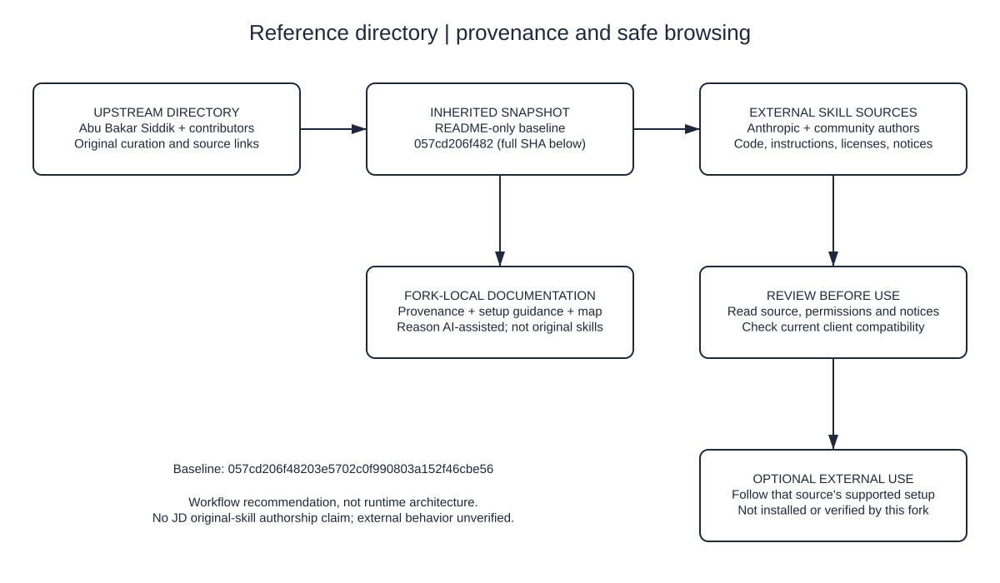

# 📦 Claude Skills Collection

**A curated collection of official and community-built Claude Skills.**  
Anthropic Skills are modular tools that extend the capabilities of Claude AI—unlocking workflows for coding, document creation, design, data analysis, research, and more.

This directory links to a selection of official and community Claude Skills. Browse by category and follow the original sources; inclusion is not a claim of completeness, compatibility, endorsement, or local implementation.

## Provenance and scope

This is a reference fork of [Abu Bakar Siddik's Claude Skills Collection](https://github.com/abubakarsiddik31/claude-skills-collection), not a JD-authored skills implementation. The inherited directory at [baseline `057cd206f48203e5702c0f990803a152f46cbe56`](https://github.com/JDKristenson/claude-skills-collection/tree/057cd206f48203e5702c0f990803a152f46cbe56) contains only this README. Its six reachable commits credit Abu Bakar Siddik and Armand du Plessis; linked skills remain the work of their respective authors and communities. Commit authors alone do not establish the full set of contributors or rule out work elsewhere.

The fork-local addition here is documentation: provenance, safe browsing/setup guidance, and a source-derived workflow map, prepared with Reason AI assistance. It does not establish original skill development or upstream contribution by JD. The inherited directory entries and source credits are retained below.

> Requirements and loading methods vary by client and skill and can change. Check the current documentation for your intended Claude client and the selected skill; this directory does not verify account-plan eligibility or installation compatibility.

### Editable provenance and browsing map

[Editable Excalidraw source](docs/provenance.excalidraw) · [SVG preview](docs/provenance.svg)

Open the `.excalidraw` file in a compatible Excalidraw editor (no external skills need installing). Boxes and arrows are editable, not a flattened image. The SVG is a matching static preview; when editing, update both files together. The map describes directory provenance and a recommended review workflow, not a running integration or evidence that any linked skill has been executed.

---

## 📚 Table of Contents

- [What Are Claude Skills?](#what-are-claude-skills)
- [Categories](#categories)
  - [📄 Document Skills](#document-skills)
  - [🎨 Creative & Design](#creative--design)
  - [💻 Development & Code Tools](#development--code-tools)
  - [📊 Data & Analysis](#data--analysis)
  - [📝 Writing & Research](#writing--research)
  - [📚 Learning & Knowledge](#learning--knowledge)
  - [🎥 Media & Content](#media--content)
  - [🤝 Collaboration & Project Management](#collaboration--project-management)
  - [🔐 Security & Testing](#security--testing)
  - [⚙️ Utility & Automation](#utility--automation)
- [Getting Started](#getting-started)
- [Contributing](#contributing)
- [License](#license)

---

## What Are Claude Skills?

Claude **Skills** are specialized modules that Claude can use to perform structured, multi-step tasks. Each skill is a lightweight folder with a clear instruction interface, and optionally includes Python code, templates, and assets.

Skills allow Claude to:
- Create and edit documents (Word, Excel, PPT)
- Parse and analyze structured data
- Write and debug code
- Generate creative visual assets
- Automate research, testing, or collaboration tasks

Official Skills are created by Anthropic and auto-invoked when needed. You can also install or build custom skills to meet your unique workflow needs.

---

## Categories

The entries below are inherited references, not locally bundled or verified skills.

## 📄 Document Skills

| Name | Description | Link |
|------|-------------|------|
| **docx** | Create and edit Microsoft Word documents with formatting, comments, and tracked changes | [Source](https://github.com/anthropics/skills/tree/main/document-skills/docx) |
| **pdf** | Extract content from PDFs, split/merge documents, or create new ones | [Source](https://github.com/anthropics/skills/tree/main/document-skills/pdf) |
| **pptx** | Generate and edit PowerPoint presentations | [Source](https://github.com/anthropics/skills/tree/main/document-skills/pptx) |
| **xlsx** | Manipulate Excel files, formulas, tables, and charts | [Source](https://github.com/anthropics/skills/tree/main/document-skills/xlsx) |

---

## 🎨 Creative & Design

| Name | Description | Link |
|------|-------------|------|
| **algorithmic-art** | Create generative art using p5.js | [Source](https://github.com/anthropics/skills/tree/main/algorithmic-art) |
| **canvas-design** | Render layout-based visual designs in PNG/PDF | [Source](https://github.com/anthropics/skills/tree/main/canvas-design) |
| **slack-gif-creator** | Generate Slack-optimized animated GIFs | [Source](https://github.com/anthropics/skills/tree/main/slack-gif-creator) |
| **brand-guidelines** | Apply company branding to outputs | [Source](https://github.com/anthropics/skills/tree/main/brand-guidelines) |
| **theme-factory** | Create and apply visual themes for documents | [Source](https://github.com/anthropics/skills/tree/main/theme-factory) |
| **nano-banana-image-generation** | Create images using Nano Banana Pro | [Source](https://github.com/livelabs-ventures/nano-skills/tree/main/skills/nano-image-generator) |

---

## 💻 Development & Code Tools

| Name | Description | Link |
|------|-------------|------|
| **artifacts-builder** | Generate clean HTML/CSS/React UI components | [Source](https://github.com/anthropics/skills/tree/main/artifacts-builder) |
| **MCP Server** | Build Claude-compatible API connectors | [Source](https://github.com/anthropics/skills/tree/main/mcp-builder) |
| **Changelog Generator** | Create changelogs from commit history | [Source](https://github.com/ComposioHQ/awesome-claude-skills/tree/master/changelog-generator) |
| **using-git-worktrees** | Manage feature branches safely in isolated Git worktrees | [Source](https://github.com/obra/superpowers/tree/main/skills/using-git-worktrees) |
| **test-driven-development** | Write tests before implementation to drive development | [Source](https://github.com/obra/superpowers/tree/main/skills/test-driven-development) |
| **subagent-driven-development** | Use multiple Claude subagents to coordinate complex implementations | [Source](https://github.com/obra/superpowers/tree/main/skills/subagent-driven-development) |
| **executing-plans** | Execute structured plans with checkpoints and verification steps | [Source](https://github.com/obra/superpowers/tree/main/skills/executing-plans) |
| **finishing-a-development-branch** | Complete development branches with testing and review flow | [Source](https://github.com/obra/superpowers/tree/main/skills/finishing-a-development-branch) |
| **preserving-productive-tensions** | Manage architectural decisions by preserving competing viewpoints to balance innovation and stability | [Source](https://github.com/obra/superpowers-skills/tree/main/skills/architecture/preserving-productive-tensions) |

---

## 📊 Data & Analysis

| Name | Description | Link |
|------|-------------|------|
| **csv-data-summarizer** | Generate statistics and charts from CSVs | [Source](https://github.com/coffeefuelbump/csv-data-summarizer-claude-skill) |
| **root-cause-tracing** | Trace and diagnose the source of data or logic errors | [Source](https://github.com/obra/superpowers/tree/main/skills/root-cause-tracing) |

---

## 📝 Writing & Research

| Name | Description | Link |
|------|-------------|------|
| **article-extractor** | Extract full content from web articles | [Source](https://github.com/michalparkola/tapestry-skills-for-claude-code/tree/main/article-extractor) |
| **Content Research Writer** | Research and refine written content with feedback | [Source](https://github.com/ComposioHQ/awesome-claude-skills/tree/master/content-research-writer) |
| **internal-comms** | Draft formal internal comms and reports | [Source](https://github.com/anthropics/skills/tree/main/internal-comms) |
| **writing-plans** | Create structured written plans with clear milestones | [Source](https://github.com/obra/superpowers/tree/main/skills/writing-plans) |
| **writing-skills** | Enhance instructional and technical writing quality | [Source](https://github.com/obra/superpowers/tree/main/skills/writing-skills) |
| **brainstorming** | Facilitate creative idea generation sessions | [Source](https://github.com/obra/superpowers/tree/main/skills/brainstorming) |

---

## 📚 Learning & Knowledge

| Name | Description | Link |
|------|-------------|------|
| **tapestry** | Build a linked knowledge graph from documents | [Source](https://github.com/michalparkola/tapestry-skills-for-claude-code/tree/main/tapestry) |
| **ship-learn-next** | Recommend next steps based on feedback loops | [Source](https://github.com/michalparkola/tapestry-skills-for-claude-code/tree/main/ship-learn-next) |
| **using-superpowers** | Learn and apply best practices for Superpowers workflows | [Source](https://github.com/obra/superpowers/tree/main/skills/using-superpowers) |
| **sharing-skills** | Learn how to contribute new skills via pull requests | [Source](https://github.com/obra/superpowers/tree/main/skills/sharing-skills) |
| **collision-zone-thinking** | Combine unrelated concepts to find new creative or problem-solving connections | [Source](https://github.com/obra/superpowers-skills/tree/main/skills/problem-solving/collision-zone-thinking) |
| **inversion-exercise** | Flip assumptions to uncover hidden insights and constraints | [Source](https://github.com/obra/superpowers-skills/tree/main/skills/problem-solving/inversion-exercise) |
| **meta-pattern-recognition** | Identify patterns across domains to uncover universal principles | [Source](https://github.com/obra/superpowers-skills/tree/main/skills/problem-solving/meta-pattern-recognition) |
| **scale-game** | Stress-test ideas at extreme scales to expose hidden weaknesses or truths | [Source](https://github.com/obra/superpowers-skills/tree/main/skills/problem-solving/scale-game) |
| **simplification-cascades** | Reduce complexity by discovering insights that simplify multiple elements at once | [Source](https://github.com/obra/superpowers-skills/tree/main/skills/problem-solving/simplification-cascades) |
| **tracing-knowledge-lineages** | Track how ideas evolve across iterations and influences | [Source](https://github.com/obra/superpowers-skills/tree/main/skills/research/tracing-knowledge-lineages) |

---

## 🎥 Media & Content

| Name | Description | Link |
|------|-------------|------|
| **youtube-transcript** | Summarize YouTube transcripts | [Source](https://github.com/michalparkola/tapestry-skills-for-claude-code/tree/main/youtube-transcript) |
| **claude-epub-skill** | Parse and analyze EPUB eBooks | [Source](https://github.com/smerchek/claude-epub-skill) |
| **Image Enhancer** | Improve resolution and clarity of screenshots | [Source](https://github.com/ComposioHQ/awesome-claude-skills/tree/master/image-enhancer) |
| **Video Downloader** | Download YouTube videos for use in Claude | [Source](https://github.com/ComposioHQ/awesome-claude-skills/tree/master/video-downloader) |

---

## 🤝 Collaboration & Project Management

| Name | Description | Link |
|------|-------------|------|
| **Meeting Insights Analyzer** | Analyze meeting dynamics and communication patterns | [Source](https://github.com/ComposioHQ/awesome-claude-skills/tree/master/meeting-insights-analyzer) |
| **Notion Integration Skills** | Official Notion connectors for Claude | [Source](https://notiondevs.notion.site/Notion-Skills-for-Claude-28da4445d27180c7af1df7d8615723d0) |
| **commands** | Manage and automate recurring project commands | [Source](https://github.com/obra/superpowers/tree/main/skills/commands) |
| **receiving-code-review** | Process and apply code review feedback | [Source](https://github.com/obra/superpowers/tree/main/skills/receiving-code-review) |
| **requesting-code-review** | Request and manage structured code reviews | [Source](https://github.com/obra/superpowers/tree/main/skills/requesting-code-review) |
| **dispatching-parallel-agents** | Coordinate multiple Claude subagents on shared tasks | [Source](https://github.com/obra/superpowers/tree/main/skills/dispatching-parallel-agents) |
| **remembering-conversations** | Recall facts, insights, and context from past Claude Code sessions | [Source](https://github.com/obra/superpowers-skills/tree/main/skills/collaboration/remembering-conversations) |

---

## 🔐 Security & Testing

| Name | Description | Link |
|------|-------------|------|
| **webapp-testing** | UI test automation using Playwright | [Source](https://github.com/anthropics/skills/tree/main/webapp-testing) |
| **ffuf_claude_skill** | Fuzz test web apps with FFUF + Claude | [Source](https://github.com/jthack/ffuf_claude_skill) |
| **defense-in-depth** | Implement multi-layered testing and security best practices | [Source](https://github.com/obra/superpowers/tree/main/skills/defense-in-depth) |
| **systematic-debugging** | Structured debugging with hypothesis testing and validation | [Source](https://github.com/obra/superpowers/tree/main/skills/systematic-debugging) |
| **testing-anti-patterns** | Identify and prevent testing anti-patterns | [Source](https://github.com/obra/superpowers/tree/main/skills/testing-anti-patterns) |
| **testing-skills-with-subagents** | Verify new skills using subagents and test cycles | [Source](https://github.com/obra/superpowers/tree/main/skills/testing-skills-with-subagents) |
| **verification-before-completion** | Run verification checks before closing tasks | [Source](https://github.com/obra/superpowers/tree/main/skills/verification-before-completion) |
| **condition-based-waiting** | Use logical conditions to control test flow timing | [Source](https://github.com/obra/superpowers/tree/main/skills/condition-based-waiting) |

---

## ⚙️ Utility & Automation

| Name | Description | Link |
|------|-------------|------|
| **file-organizer** | Clean up file structures, rename documents | [Source](https://github.com/ComposioHQ/awesome-claude-skills/tree/master/file-organizer) |
| **invoice-organizer** | Parse and categorize invoices | [Source](https://github.com/ComposioHQ/awesome-claude-skills/tree/master/invoice-organizer) |
| **raffle-winner-picker** | Pick winners using secure randomness | [Source](https://github.com/ComposioHQ/awesome-claude-skills/tree/master/raffle-winner-picker) |
| **skill-creator** | Build your own skill interactively | [Source](https://github.com/anthropics/skills/tree/main/skill-creator) |
| **template-skill** | A starting template for new skills | [Source](https://github.com/anthropics/skills/tree/main/template-skill) |
| **using-superpowers** | Automate Superpowers workflows and validation tasks | [Source](https://github.com/obra/superpowers/tree/main/skills/using-superpowers) |
| **gardening-skills-wiki** | Maintain the skills wiki, ensuring naming consistency and metadata quality | [Source](https://github.com/obra/superpowers-skills/tree/main/skills/meta/gardening-skills-wiki) |
| **pulling-updates-from-skills-repository** | Sync and pull the latest skill updates from repositories | [Source](https://github.com/obra/superpowers-skills/tree/main/skills/meta/pulling-updates-from-skills-repository) |

---

## Getting Started

### Browse this repository

Read this README on GitHub or in a text editor. No dependency installation, credentials, environment variables, build step, or service is needed to browse it. This is a documentation directory: there is no local skill package, application, manifest, build system, or test suite. No native setup/build/test command is defined; do not infer that cloning this repository installs skills.

### Evaluate an external skill separately

1. Follow the selected entry's original source link. Links and descriptions are inherited references and may move or become outdated.
2. Read that source's current instructions, `SKILL.md` (if present), scripts, dependencies, permissions, license, attribution, and nested notices before use. Preserve applicable human, community, and AI credits.
3. Check the current loading/install procedure for your intended Claude client. Do not assume a repository URL or folder can be loaded by every client.
4. Only after review, follow that source's supported setup in an appropriate isolated environment, using non-sensitive sample data and least privilege. Never paste real credentials or private data into examples, diagrams, or issues.

This documentation change did not install or execute linked skills, validate credentials, or verify external links, licenses, compatibility, or behavior.

---

## Contributing

Have a skill to add?  
Open a pull request or submit your repo link in an issue with:

- Name of the skill  
- Short description  
- Category  
- Link to the source

---

## License

This repo lists and links to skills under various licenses.  
Please refer to each linked repository for license terms.

No standalone license file is present in the inherited baseline. The statement above describes the linked works; it does not grant a new license to this directory text or its documentation additions. Do not assume upstream or third-party rights can be relicensed here. Preserve applicable notices and attribution, including notices nested in any separately obtained skill.

---
